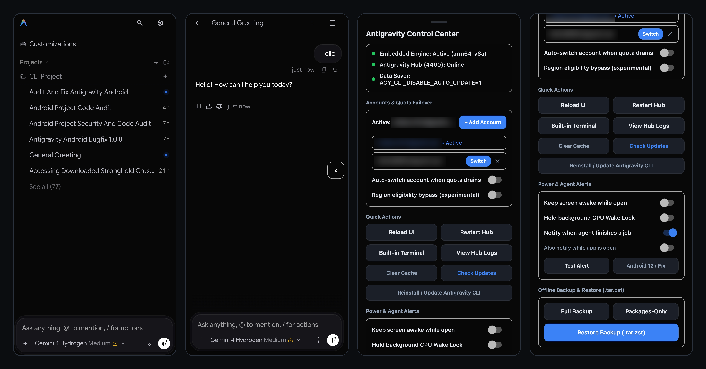

<div dir="rtl">

# آنتی‌گرویتی برای اندروید

[English](README.md) | **فارسی**

[](https://github.com/MasterPieceZez/antigravity-android/releases) [](https://github.com/MasterPieceZez/antigravity-android/actions/workflows/build-release.yml)  

اپلیکیشن مستقل و غیررسمی اندروید برای اجرای کامل **Google Antigravity (`agy`)** روی گوشی بدون نیاز به روت یا PRoot.

پروژه **antigravity-android** محیط لینوکسی Termux را در قالب یک فایل APK یکپارچه بسته‌بندی کرده و سرویس `agy --hub` را به‌صورت بومی و محلی روی دستگاه اجرا می‌کند؛ سپس رابط وب آنتی‌گرویتی را در یک محیط تمام‌صفحه، روان و بهینه در اختیار شما قرار می‌دهد.

> این پروژه وابستگی رسمی به Google LLC یا تیم Termux ندارد.

## پیش‌نمایش رابط کاربری



## قابلیت‌های برجسته

- **محیط لینوکسی یکپارچه و مستقل:** هسته Termux، سرویس پس‌زمینه و ترمینال داخلی را با شناسه بسته اختصاصی (`com.agy.os`) در خود جای داده و بدون تداخل در کنار Termux اصلی نصب می‌شود.
- **اجرای تمام‌صفحه هاب محلی (`localhost:4400`):** پشتیبانی از احراز هویت OAuth از طریق مرورگر امن، آپلود و دانلود مستقیم فایل‌ها، و ورودی میکروفون برای تبدیل گفتار به متن.
- **نصب خودکار با نمایشگر پیشرفت زنده:** دریافت و نصب CLI رسمی آنتی‌گرویتی با نمایش درصد پیشرفت و سرعت لحظه‌ای دانلود.
- **مدیریت چندحسابه و جابه‌جایی خودکار سهمیه:** نگهداری امن توکن‌ها با رمزنگاری Android Keystore و سوئیچ خودکار به حساب بعدی هنگام اتمام سهمیه.
- **آپدیتر بومی درون‌برنامه‌ای:** دریافت مستقیم نسخه‌های جدید از GitHub Releases، بررسی یکپارچگی با چک‌سام `SHA256SUMS.txt` و نصب فوری بدون نیاز به مرورگر.
- **ترمینال داخلی حرفه‌ای:** قابل دسترس از طریق دکمه شناور همراه با کلیدهای کمکی (`ESC`، `TAB`، `CTRL`/`ALT` چسبان، کلیدهای جهت‌نما) و تنظیم اندازه فونت.
- **اعلان‌های هوشمند و اشتراک‌گذاری فایل:** ارسال نوتیفیکیشن هنگام اتمام وظایف ایجنت در پس‌زمینه و دریافت مستقیم فایل‌ها از منوی Share اندروید در پوشه `~/inbox` یا `Download/AntigravityInbox`.
- **پشتیبان‌گیری آفلاین و مهاجرت از Termux:** مجهز به `zstd` نسخه 1.5.7 برای ساخت بکاپ `.tar.zst`، بازیابی سریع و انتقال کامل محیط Termux قبلی به اپلیکیشن.
- **دور زدن اختیاری محدودیت منطقه (تجربی):** گزینه اختیاری با تاییدیه صریح کاربر در Control Center برای رفع خطای محدودیت منطقه‌ای حساب کاربری.

## راهنمای نصب و راه‌اندازی

### نصب تازه
1. از بخش [Releases](https://github.com/MasterPieceZez/antigravity-android/releases)، فایل `AntigravityStandalone-v<version>-arm64-v8a.apk` (یا نسخه `universal`) را دریافت کنید. اجرای Antigravity CLI نیازمند دستگاه ۶۴ بیتی (`arm64-v8a` یا `x86_64`) است. برای آپدیت‌های بعدی می‌توانید از نسخه سبک `AntigravityUpdate-v<version>-universal-lite.apk` یا آپدیتر داخلی برنامه استفاده کنید.
2. برنامه را باز کرده، دسترسی‌های پیشنهادی حافظه و باتری را تایید کنید (اختیاری) و روی **Install Antigravity Automatically** بزنید.

### انتقال از Termux قبلی
در اپلیکیشن Termux فعلی خود دستور زیر را اجرا کنید:

</div>

<div dir="ltr">

```bash
pkg install -y zstd tar && tar -cf - -C /data/data/com.termux/files --exclude='./usr/var/cache/*' --exclude='./usr/tmp/*' ./usr ./home | zstd -6 -T2 -o /sdcard/Download/termux-port.tar.zst && zstd -t /sdcard/Download/termux-port.tar.zst
```

</div>

<div dir="rtl">

سپس وارد آنتی‌گرویتی شوید و گزینه **Import Backup / Port Termux (.tar.zst)** را انتخاب کنید؛ مسیرهای داخلی آرشیو به‌طور خودکار به `com.agy.os` نگاشت می‌شوند.

## نکات امنیتی

- درخواست‌های پل ارتباطی محلی روی پورت `127.0.0.1:4401` هدرهای `Host` و `Origin` را اعتبارسنجی کرده و نیازمند توکن تصادفی اختصاصی هر نصب در مسیر `~/.agy_bridge/bridge.token` (با سطح دسترسی `0600`) هستند.
- ترافیک HTTP غیررمزنگاری‌شده در WebView از طریق `network_security_config.xml` صرفاً به `localhost` و `127.0.0.1` محدود شده و دسترسی به مسیرهای `file://` مسدود است.
- پل ارتباطی جاوااسکریپت و انتخابگر فایل تنها برای مبدأهای معتبر هاب محلی فعال می‌شوند.

## مجوز و سخت‌افزارهای تست‌شده

- منتشرشده تحت مجوز **GPL-3.0**، منشعب از [termux/termux-app](https://github.com/termux/termux-app).
- توسعه‌یافته با کمک هوش مصنوعی و تست‌شده روی دستگاه‌های واقعی (POCO X3 NFC، POCO X3 GT، POCO X6 PRO، Samsung Galaxy A55 و Samsung Galaxy A36).

</div>
