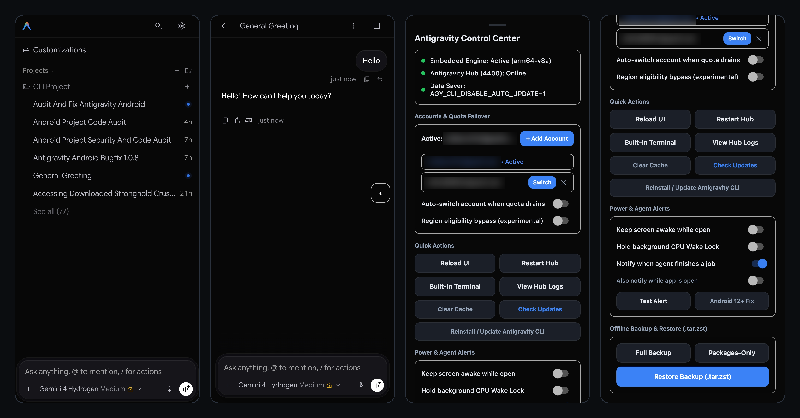

# Antigravity for Android

**English** | [فارسی](README.fa.md)

[](https://github.com/MasterPieceZez/antigravity-android/releases) [](https://github.com/MasterPieceZez/antigravity-android/actions/workflows/build-release.yml)  

An unofficial standalone Android app for Google Antigravity (`agy`). It bundles the Termux Linux environment inside one APK, runs `agy --hub` locally without root or PRoot, and opens the Antigravity Web UI in a fullscreen WebView.

> Not affiliated with Google LLC or the Termux project.

## Preview



## What's included

- Bundles the Termux bootstrap, foreground service, and terminal session into one APK under its own package ID (`com.agy.os`), so it works alongside stock Termux.
- Opens the local Hub (`localhost:4400`) in a fullscreen WebView with external browser handoff for OAuth logins and native file uploads/downloads.
- Installs the official Antigravity CLI automatically with live download progress (`%`) and transfer speed reporting.
- Supports multi-account credential snapshots encrypted with Android Keystore and automatic quota-exhaustion failover between accounts.
- Includes a native in-app APK updater (`InAppUpdater`) that downloads releases directly from GitHub, verifies `SHA256SUMS.txt`, and launches the Android package installer.
- Includes an opt-in experimental region eligibility bypass in Control Center gated behind an explicit disclaimer dialog.
- Supports microphone input in the WebView for speech-to-text, plus Android notifications when background agent tasks finish.
- Includes a built-in terminal (openable from the floating control pill) with extra keys (`ESC`, `TAB`, sticky `CTRL`/`ALT`, arrows, symbols) and font zoom controls.
- Lets you share files into Antigravity via Android's Share sheet (`~/inbox` or `Download/AntigravityInbox`).
- Bundles `zstd` 1.5.7 for offline `.tar.zst` backups, restores, and migrating an existing Termux setup.

## Setup

### Fresh install
1. Download `AntigravityStandalone-v<version>-arm64-v8a.apk` (or `universal`) from [Releases](https://github.com/MasterPieceZez/antigravity-android/releases). A 64-bit (`arm64-v8a` or `x86_64`) device is required by the Antigravity CLI. Later app updates can use `AntigravityUpdate-v<version>-universal-lite.apk` without re-downloading the full bootstrap.
2. Open the app, grant storage/battery permissions if prompted (optional—downloads and shares fall back to MediaStore / `~/inbox`), and tap **Install Antigravity Automatically**.

### Port from an existing Termux install
In your existing Termux app, run:
```bash
pkg install -y zstd tar && tar -cf - -C /data/data/com.termux/files --exclude='./usr/var/cache/*' --exclude='./usr/tmp/*' ./usr ./home | zstd -6 -T2 -o /sdcard/Download/termux-port.tar.zst && zstd -t /sdcard/Download/termux-port.tar.zst
```
Then open Antigravity and choose **Import Backup / Port Termux (.tar.zst)**. Paths inside the archive are remapped to `com.agy.os` during restore.

## Security notes
- Local bridge requests on `127.0.0.1:4401` validate `Origin` headers and require a per-install random token stored at `~/.agy_bridge/bridge.token` (`0600`).
- Cleartext HTTP in the WebView is restricted to `localhost` and `127.0.0.1` via `network_security_config.xml`, and `file://` WebView access is disabled.

## License
- **GPL-3.0**, forked from [termux/termux-app](https://github.com/termux/termux-app).
- Built with AI assistance and tested on real hardware (POCO X3 NFC, POCO X3 GT, POCO X6 PRO, Samsung Galaxy A55, Samsung Galaxy A36).
